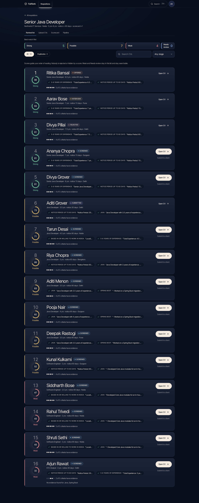
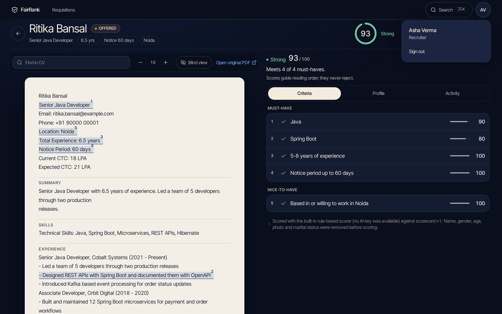
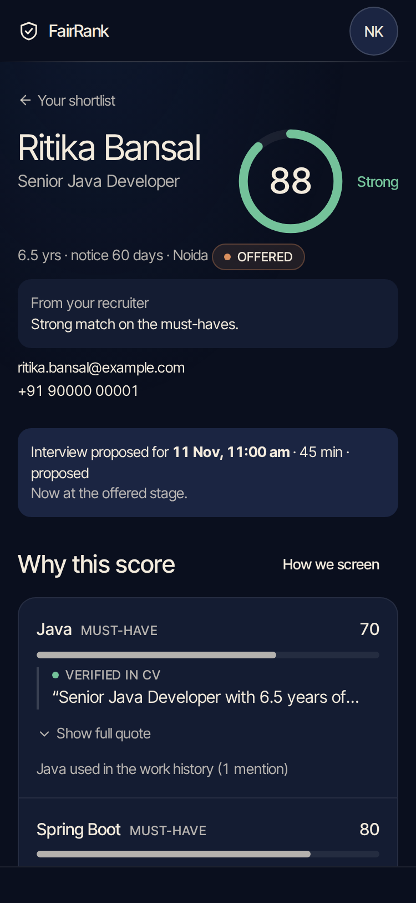
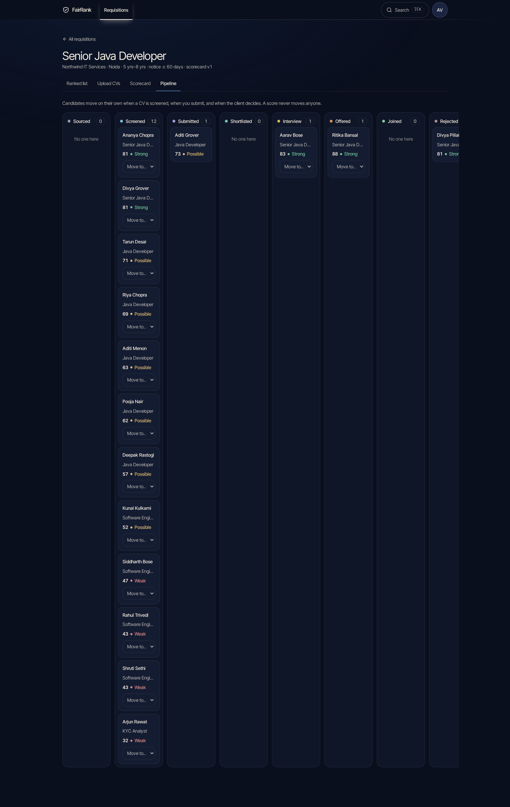

# FairRank

AI resume screening for recruiters, and a phone-first shortlist portal for clients. Every score shows its evidence, nobody is ever auto-rejected, and the scoring step never sees a candidate's name, gender, age, photo or marital status (people on the screens do see some of them; see "Who sees what" below).

Built for Company A (a Noida staffing firm: IT services, banking back-office, retail) as a solo project. Core slice: recruiter and client hiring-manager roles, plus a delivery-head view.

**Live demo:** https://fairrank.vincents.systems (synthetic data only; demo logins below)



## What it does

| For | What you get |
|---|---|
| **Recruiter** | Paste a job description and get an editable, versioned scorecard. Bulk-upload up to 500 PDF or DOCX CVs. See the best candidates first, each with a quoted reason per criterion. Open a candidate, then submit them to the client. |
| **Client hiring manager** | A phone-first shortlist of only the candidates submitted to your organisation. Shortlist, reject with a reason, or propose an interview slot. Contacts stay masked until the interview stage. A "How we screen" panel explains the AI in plain language. |
| **Delivery head** | A pipeline per requisition (sourced, screened, submitted, shortlisted, interview, offered, joined) and an AI-versus-recruiter agreement report. |



## The rules it enforces (each has a test)

1. **Never auto-reject.** Low scorers are labelled, never hidden. No code path changes a candidate's stage from a score.
2. **Every score shows evidence.** The quote must be an exact substring of the CV text (whitespace normalised). If it isn't, the quote is dropped and the criterion reads "No evidence found". A title or a skills list alone is capped, because a keyword is not proof of work done.
3. **Blind scoring.** Name, gender, age, photo and marital status (plus contacts, family names and gendered pronouns) are removed in `ai/redact.py` before any text goes to the scorer. This protects the **score**; it does not hide anything from the people using the app (see below).
4. **Open before submit.** A recruiter can submit a candidate only after opening the CV. Enforced on the server (403), not just in the UI.
5. **Client isolation.** Clients only see candidates submitted to their organisation, through one queryset. Another organisation's candidate is a 404.
6. **Masked contacts** for clients until the interview stage.
7. **View log.** Every open of a profile or CV is recorded (who, what, when).
8. **Consent and deletion.** Consent is recorded per candidate. Deletion on request wipes the file, text, parsed fields and scores, and leaves a tombstone.
9. **Honest unsure states.** A scanned PDF reads "Needs manual review" with no fake score. An AI failure reads "Scoring failed, retry" with the CV still visible. Low confidence reads "Unverified".
10. **No secrets in the repository.** Everything comes from the environment, and every CV in the repo is synthetic.

## Who sees what

Blind scoring means the **score** is computed without identity. It does not make the screens anonymous.

| | Recruiter | Client hiring manager | The scorer (LLM or offline) |
|---|---|---|---|
| Name | Shown | Shown | Removed |
| Email and phone | Shown | Masked (`a•••@e•••.com`) until the interview stage, then shown | Removed |
| Gender, age or date of birth, marital status, photo, nationality, religion, caste, family names (labelled CV lines) | Shown in the CV | Replaced with `[hidden]` | Removed |
| Gendered pronouns in the CV's prose | Shown | Shown (not rewritten) | Neutralised |
| The rest of the CV | Shown | Shown | Shown |

The recruiter can switch on **Blind view** on the candidate page to mask identity in what they are reading. Clients never receive the raw values for masked fields; masking happens on the server.

**Known gap, stated plainly:** a client sees the candidate's name and any pronouns in the CV's prose, so they can still infer gender. Blind scoring keeps identity out of the ranking, not out of the client's own decision. Hiding names from clients too is a product choice the brief did not ask for.

## Run it locally (about 5 minutes)

Needs Docker with Compose. No API key is required: with none set, a built-in rule-based scorer runs and the UI says so.

```bash
git clone https://github.com/VincentSamuelPaul/FairRank.git && cd FairRank
cp .env.example .env
# edit .env: set SECRET_KEY (32+ characters), POSTGRES_PASSWORD, DEBUG=true. Leave the rest blank.
docker compose up -d --build
docker compose exec web python manage.py migrate
docker compose exec web python manage.py seed
```

Open http://localhost:5173.

### Demo logins

All synthetic. Password for every account: `FairRank-demo-1` (unless you set `SEED_PASSWORD`).

| Role | Email |
|---|---|
| Recruiter | recruiter1@companya.example (also recruiter2@) |
| Delivery head | head@companya.example |
| Client, Northwind IT Services | manager@northwind.example |
| Client, Meridian Bank Operations | manager@meridian.example |

Things to try: open a candidate and watch **Submit to client** unlock; look for a criterion that reads "No evidence found"; open the scanned KYC CV; sign in as the other client and confirm none of the first client's candidates are visible; propose an interview slot and watch the contacts unmask.



## How it works

```
 Browser (React SPA, phone first)
        |  same origin
   Caddy  --- serves the Vite build, proxies /api and /admin
        |
   Django 5 + DRF (gunicorn)  <---->  PostgreSQL
        |
   Job table  <----  run_worker (parses CVs, scores, weekly report)  ---->  LLM: Groq / Gemini (or offline)
```

- **Backend:** Python 3.12, Django 5 and Django REST Framework. Business logic lives in `services.py` per app, views stay thin. DRF serializers validate input, and Pydantic validates every LLM answer.
- **Frontend:** React, Vite, TypeScript, React Router, TanStack Query, Tailwind v4, React Hook Form and Zod.
- **Database:** PostgreSQL, with constraints behind the rules (a score exists only when the status is "scored", a quote only when verified).
- **Queue:** a `Job` table and `python manage.py run_worker`. No Celery or Redis. It works in small batches and backs off exponentially on rate limits.
- **LLM:** one function, `ai/llm.py::call_llm(prompt, schema)`. Groq is primary with Gemini as fallback, chosen by environment. Invalid JSON gets one retry. Scores are cached by CV hash and scorecard version.
- **Parsing:** rule-based (`pdfplumber`, `python-docx`, `rapidfuzz` for duplicates). The LLM is used only for JD intake and scoring.
- **Auth:** Django session cookies with CSRF, role-based DRF permissions, default deny.

```
backend/   config/ accounts/ requisitions/ candidates/ screening/ portal/ audit/ ai/ seed/ e2e/
frontend/  src/pages  src/components  src/lib
docs/      BRIEF.md  TDD.md  DESIGN.md  PLAN.md  INTERVIEW_NOTES.md  screens/
scripts/   qa.sh  login-fit.sh  e2e-ui.sh  prod-smoke.sh  deploy.sh  backup.sh  build-submission.sh
```



## Tests

| What | Command | Last result |
|---|---|---|
| Backend (pytest) | `docker compose exec web python -m pytest` | 279 passed |
| Frontend (Vitest) | `docker compose exec frontend npx vitest run` | 32 passed |
| Types and lint | `docker compose exec frontend npx tsc -b` and `npm run lint` | 0 errors |
| Rendered UI checks | `scripts/qa.sh` | 82 passed |
| Login fits 13 screen sizes | `scripts/login-fit.sh` | 13 of 13 |
| Browser end-to-end, every role | `scripts/e2e-ui.sh` (see `deployment.md`) | 36 of 36 |
| Production build smoke test | `BASE=http://localhost:8080 scripts/prod-smoke.sh` | 34 of 34 |

The browser suites run in a Playwright Docker image that is pulled the first time (about 3.5 GB).

## Deploy

`deployment.md` has the full procedure, including a 20-minute checklist for a home server with either a Cloudflare Tunnel or a port forward. In short: Docker Compose runs Postgres, Django behind gunicorn, the worker and Caddy, with health checks on each. `scripts/deploy.sh` pulls, builds, migrates and restarts, and `scripts/backup.sh` dumps the database and uploads. Production settings refuse to start without a strong `SECRET_KEY`.

## Documentation

| File | What it is |
|---|---|
| [docs/BRIEF.md](docs/BRIEF.md) | The client brief and every labelled assumption (A1 to A23) |
| [docs/TDD.md](docs/TDD.md) | Technical design: architecture, data model, AI behaviour and failure modes, testing |
| [docs/DESIGN.md](docs/DESIGN.md) | Design language: tokens, type, components |
| [deployment.md](deployment.md) | Run, test and deploy, with environment variable names |
| [docs/INTERVIEW_NOTES.md](docs/INTERVIEW_NOTES.md) | Short spoken answers about the design decisions |
| [TESTING.md](TESTING.md) | How to run each test layer |
| [backend/seed/README.md](backend/seed/README.md) | The seed data, and why all of it is synthetic |

## Limits

Scanned PDFs are flagged for a person, not OCR'd. Email and SMS are mocked. Free-tier LLM quotas cap batch speed. The live demo may run in development mode. See section 10 of the TDD for the full list.
